<a href="https://anaarezo.github.io">
  <picture>
    <source media="(prefers-color-scheme: dark)" srcset="assets/hero-dark.svg">
    <source media="(prefers-color-scheme: light)" srcset="assets/hero-light.svg">
    
  </picture>
</a>

  
  
  

## About

I'm a Lead Front End Engineer in London, currently at Curation. My mission is to build an inclusive, seamless and accessible web, where knowledge flows as effortlessly as a perfectly brewed cup of tea. ☕️

Over 16+ years I've engineered software from the intricate vaults of financial institutions to the bustling world of e-commerce. For more than 10 of those years I've studied how people really use interfaces, then shaped those interfaces to feel as intuitive as instinct.

Today I'm taking that craft further into mobile app development, while keeping my toolkit sharp with AWS, Python and Generative AI.

<picture>
  <source media="(prefers-color-scheme: dark)" srcset="assets/highlights-dark.svg">
  <source media="(prefers-color-scheme: light)" srcset="assets/highlights-light.svg">
  
</picture>

## Toolkit

  

## Selected work

| Project | Summary |
| --- | --- |
| [react-native-a11y-components](https://github.com/anaarezo/react-native-a11y-components) | A collection of accessible React Native components |
| [carousel-play-pause-react-native](https://github.com/anaarezo/carousel-play-pause-react-native) | A React Native carousel with play and pause, and a progress bar on its pagination |
| [react-native-1001](https://github.com/anaarezo/react-native-1001) | A library of React Native components |

## Activity

  <picture>
    <source media="(prefers-color-scheme: dark)" srcset="https://streak-stats.demolab.com?user=anaarezo&theme=dark&hide_border=true&background=00000000">
    
  </picture>

